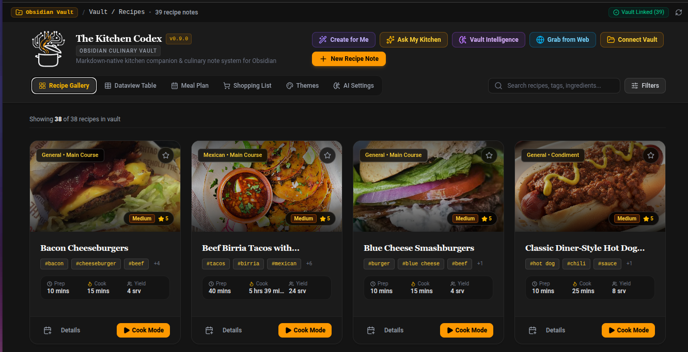

# The Kitchen Codex

**The recipes you love deserve a home.**

[](package.json)
[](LICENSE)

**The Kitchen Codex** is a **standalone, local-first recipe and cooking workspace**. Save the recipes you love, keep them together in **My Recipe Vault**, plan meals, build shopping lists, cook step by step, and understand your recipes' nutrition.

**Obsidian is optional.** The Kitchen Codex works as its own application. Its Markdown-based recipe format also makes it friendly to Obsidian users, but you do not need Obsidian to use it.

[**Official website**](https://kitchencodex.app) · [**Get started locally**](#run-it-locally) · [**Current release**](#whats-available-now) · [**Roadmap**](#where-were-heading) · [**Issues & feedback**](https://github.com/kryptek2000/The-Kitchen-Codex/issues)

<p align="center">
  
</p>

> **Release status — v0.9.0:** This README distinguishes features in the published version from development work and future product direction. SHISO's H-2 editing workflow is **uncommitted and awaiting independent audit and real-browser acceptance**. It is **not part of v0.9.0**. Advanced Nutrition is also **not included in v0.9.0**. No paid tier, subscription, hosted Kitchen Codex Cloud, or mobile app is being offered by this release.

---

## 🍃 The idea: one home for your cooking

The Kitchen Codex is built around a simple flow:

**Save → Protect in My Recipe Vault → Organize → Plan → Shop → Cook → Understand nutrition**

Your Recipe Vault is the home for your recipe collection, not another company's product name. Today the application can work with local recipe files, including Obsidian-compatible Markdown. Different storage providers, hosted Vaults, and richer sync options are **future directions**, not current integrations.

You can start with your existing recipes or create new ones. Keep your collection yours, and choose when to use optional AI services.

## ✨ What's available now

The following describes the **published v0.9.0 application**, not every experiment in the development worktree.

| Your kitchen workflow | What The Kitchen Codex offers |
| --- | --- |
| **My Recipe Vault** | Browse, search, filter, favorite, create, and edit recipes with local-file workflows. |
| **Save recipes from elsewhere** | Import recipes from supported web pages, structured recipe data, or supplied text, with a preview before saving. |
| **Create recipes** | Write recipes manually or use the existing **Create for Me** AI draft feature where a configured, verified provider is available. Generated drafts are not saved automatically. |
| **Organize and rediscover** | Explore related recipes, recipes using an ingredient, useful tags, and culinary similarity. |
| **Plan meals** | Plan breakfast, lunch, and dinner across a seven-day calendar. |
| **Shop from your plan** | Build a grocery checklist from planned recipes and copy a shopping list. |
| **Cook with focus** | Use recipe cards, step-by-step Cooking Mode, ingredient scaling, and recipe timers. |
| **Keep and share recipe information** | Print/export recipe cards and preserve supported recipe metadata, notes, images, and Markdown formatting. |
| **Work with recipe images** | Find licensed representative images or explicitly request AI generation using supported providers; check provider pricing before making paid image requests. |
| **View existing nutrition** | Display, edit, scale, and preserve usable saved or imported nutrition data. Automated untrusted nutrition values are not silently treated as verified. |

**AI functionality is conditional.** Provider/model availability, credentials, verification, product gates, and possible charges affect which AI actions can run. Core recipe editing, planning, shopping, and cooking do not depend on having an AI account.

### The Kitchen Codex Vault and Obsidian

**Obsidian is an integration, not a requirement or parent product.** If you already use Obsidian, The Kitchen Codex supports local recipe folders and compatible Markdown/YAML frontmatter, including wikilinks such as `[[Garlic]]` and `[[Chicken Breast|chicken]]`. It can read and save local recipe files through supported browser directory access.

If you have never heard of Markdown or Obsidian, that's fine: the goal is a recipe organizer first, with technical file compatibility available when you want it.

An **official Obsidian plugin**, additional storage-provider integrations, hosted Vault options, and richer cross-device sync remain part of the **multi-surface roadmap**; do not assume they are included with v0.9.0.

## 🌿 Meet SHISO — Your AI Kitchen Companion

**One companion. One conversation. Different places to start.**

**SHISO** is the planned unified AI kitchen companion for The Kitchen Codex. The direction is to talk naturally with one assistant whether you're in your Recipe Vault, looking at a recipe, planning a meal, or reviewing nutrition. Future entry points use names such as **Chat with SHISO**, **Ask SHISO**, and **Create with SHISO**, not separate recipe and nutrition chatbots.

The intended workflow is practical: ask SHISO to make a recipe, change ingredients, investigate nutrition issues, plan with your own recipes, or help while cooking. **SHISO interprets and coordinates; The Kitchen Codex's existing application systems validate and perform the work.**

### SHISO development status — not a released feature

Current internal H-2 development has **reported** implementation of authorized working-copy ingredient edits, USDA-backed nutrition corrections, deterministic recalculation, undo/discard, and explicit user-authorized saving via the existing Vault writer. These claims still require independent audit and real-user browser testing; the work is **uncommitted and unavailable in the published v0.9.0 release**.

The intended trust model:

- SHISO can help carry out **user-requested** changes through application-controlled tools, not through unrestricted access to local files.
- The application—not a language model—selects authenticated food data, derives weights, and calculates nutrition.
- Changes should be visible and undoable, and **saving to the Vault requires an explicit user instruction or trusted save action**.
- Ambiguous ingredient identities or measurements stay reviewable; missing facts are not invented.
- A successful conversational response alone is not proof that data was changed or saved.

Earlier features named **Ask My Kitchen**, **Ask This Recipe**, and **Create for Me** are historical/shipped capabilities, **not separate assistant brands in the forward plan**. Existing features will not be removed or renamed merely by this README; the unification is a staged development program.

## 🥗 Nutrition: useful basics, verified depth

The long-term nutrition strategy has two complementary levels:

| | Basic Nutrition | Advanced Nutrition |
| --- | --- | --- |
| **Product direction** | Free everyday nutrition functionality, including usable nutrition already present in recipes. | Premium AI-assisted interpretation of difficult ingredient and portion wording. |
| **Calculation trust** | Preserve the distinction between known, unknown, and manually edited data. | Authenticate food identities/USDA source portions, calculate deterministically, disclose incomplete coverage, and retain review/provenance. |
| **v0.9.0 availability** | Existing and imported nutrition display/edit/scale workflows. | **Not included in v0.9.0.** In development and testing. |

**SHISO understands. The Kitchen Codex verifies. You stay in control.**

Advanced Nutrition is designed to use AI for interpretation, not as a source of invented calories, grams, food identities, or nutrient totals. Genuine gaps stay unresolved until supported evidence or user input is available. Nutrition outputs are estimates, not individualized medical advice.

The free/premium distinction is a **product strategy**; this repository does not currently provide a hosted subscription or billing service.

## 🧭 Where we're heading

The Kitchen Codex is intended to grow into **one product core across several ways to cook and manage recipes**. These items are **plans, not shipping claims or timelines**.

| Direction | Planned experience |
| --- | --- |
| **SHISO everywhere** | One conversational companion for creation, editing, Vault search, nutrition, planning, shopping, and cooking assistance. |
| **Advanced Nutrition** | Wider real-world ingredient understanding using authenticated USDA evidence and the existing deterministic engine. |
| **Collections** | Organize recipes into named groups, dietary collections, and cuisines. |
| **Spice Rack** | Manage spices and seasonings and connect them to recipes. |
| **Ingredient substitutions** | Show appropriate substitutions through a verified application workflow. |
| **Smarter planning and cooking** | Leftover-aware suggestions, linked cooking timer chains, and more useful meal workflows. |
| **More places to use your Vault** | Standalone desktop distribution, an official Obsidian plugin, and a mobile/PWA companion as each surface is completed and verified. |
| **More ways to capture and store recipes** | Additional import sources, social recipe capture where supported, and optional future storage/cloud integrations. |
| **Nutrition diary** | Possible later recipe-aware food logging and nutrient tracking, conditional on Advanced Nutrition accuracy and release gates. |

**Not currently offered:** Kitchen Codex Cloud, Google Drive/Notion sync, social-network connectors, paid subscriptions, nutrient tracking, or a released mobile companion. Specific integrations will be announced only when real and supportable.

For the product architecture and long-term direction, see the [SHISO architecture roadmap](docs/Shiso-Architecture-and-Roadmap.md) and the [official website's product/brand planning](https://github.com/kryptek2000/The-Kitchen-Codex-Website/blob/main/docs/Website-Master-Plan.md). These are living planning documents: some older implementation-status statements predate the current development work.

## 🚀 Run it locally

The Kitchen Codex is currently a local full-stack React + Node application. **Obsidian is not required.** The repository's reproducible dependency path uses [Bun](https://bun.sh/) and its committed `bun.lock` file.

**Requirements:** Git, Bun, a supported desktop browser, and a local Node-compatible runtime. AI provider credentials are optional for non-AI features.

```bash
git clone https://github.com/kryptek2000/The-Kitchen-Codex.git
cd The-Kitchen-Codex
bun install --frozen-lockfile
cp .env.example .env
bun run dev
```

Open **http://localhost:3000**.

To connect local files in a compatible Chromium-based browser, use **Connect Vault → Select Vault Directory**, choose your recipe folder, and grant access. The browser File System Access API manages local directory permissions. You can also use the supported importer workflows.

### Optional AI setup

Some features require a supported AI provider, model, and credentials. Start with [`.env.example`](.env.example) and the in-app AI settings where available. **Do not commit credentials to GitHub.** Provider requests may use paid credits, depending on your selection and account.

The environment variable `KITCHEN_CODEX_NUTRITION_PRODUCT_TIER=ai_advanced` is a **development/product-access gate**, not a subscription, not a way to unlock unreleased Advanced Nutrition in v0.9.0, and not a substitute for valid provider access.

### Build and test

```bash
bun run lint         # TypeScript type checking
bun run build        # Frontend + bundled server
bun run start        # Start the production build locally
bun run test         # Automated test suite
```

For a production/LAN/public deployment, review the included security configuration carefully. The app binds to loopback by default; exposing AI endpoints requires appropriate authentication (including `AI_ENDPOINT_TOKEN` when applicable), rate limiting, reverse-proxy settings, and a deliberate deployment security review. **The repo is not a ready-made hosted multi-user service.**

## 🧰 Under the hood

The application uses **React 19**, **TypeScript**, **Vite**, an **Express/Node** API, and a local-first recipe/Markdown data model. It supports Obsidian-compatible Markdown and YAML frontmatter without requiring Obsidian.

AI operations go through guarded provider infrastructure rather than granting models direct file or nutrition authority. The developing Advanced Nutrition system is grounded in USDA FoodData Central with authenticated records, review states, and deterministic calculations. See [Advanced Nutrition Architecture](docs/Advanced-Nutrition-Architecture.md) for implementation-level detail; that document includes historical phase records and should not be read as a v0.9.0 shipping checklist.

## 🔐 Data ownership and product trust

- **Local-first:** the current desktop-browser workflow keeps your recipe files under your chosen local file access. External AI services are separate, optional capabilities.
- **Your confirmation matters:** imported/generated recipe drafts are reviewed before saving. Uncommitted SHISO editing is being designed around application-authorized changes and explicit saves.
- **Nutrition transparency:** a missing amount or unsupported match must not become a fabricated nutrient result.
- **No invented integrations:** desktop/mobile apps, cloud storage, social importers, and paid tiers are only called available once verified and released.
- **Your own provider costs:** AI or image-generation providers may charge independently of The Kitchen Codex.

## 🤝 Contributing and feedback

This project is open source and developed in public. Bugs, feature ideas, and contributions are welcome through [GitHub Issues](https://github.com/kryptek2000/The-Kitchen-Codex/issues).

**Release authority:** New versions and major deployment decisions are approved by the project owner. An implementation report or passing tests alone does not mean SHISO or Advanced Nutrition has shipped.

## 📄 License

[MIT License](LICENSE).

---

## 📌 Release history

For **all published versions**, fixes, release dates, and technical changes, see the canonical [CHANGELOG.md](CHANGELOG.md). The current repository release is **v0.9.0**; SHISO H-2 and Advanced Nutrition development work are **not yet part of that release**.

Historical standalone release-note files are no longer maintained in the repository root. Git tags and GitHub Releases retain version-specific history.

